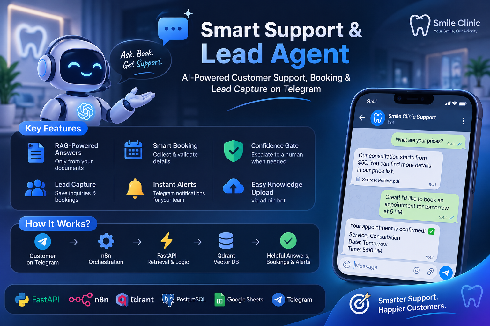
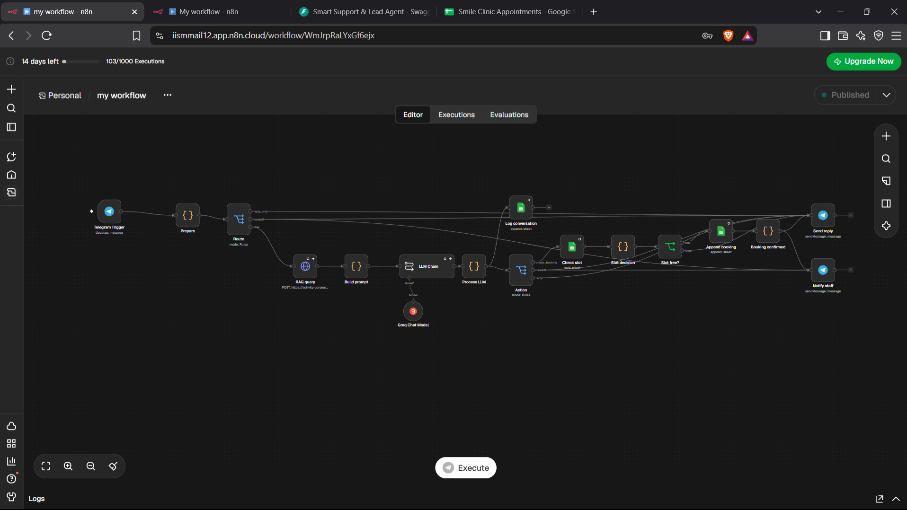
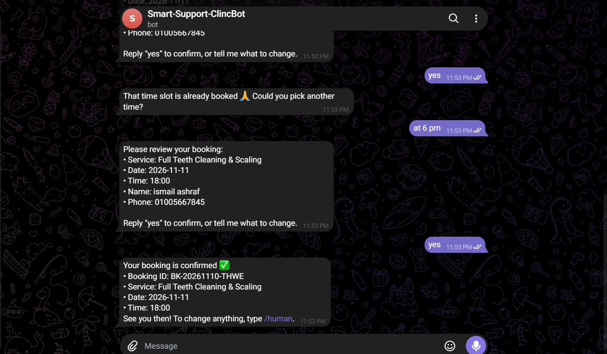
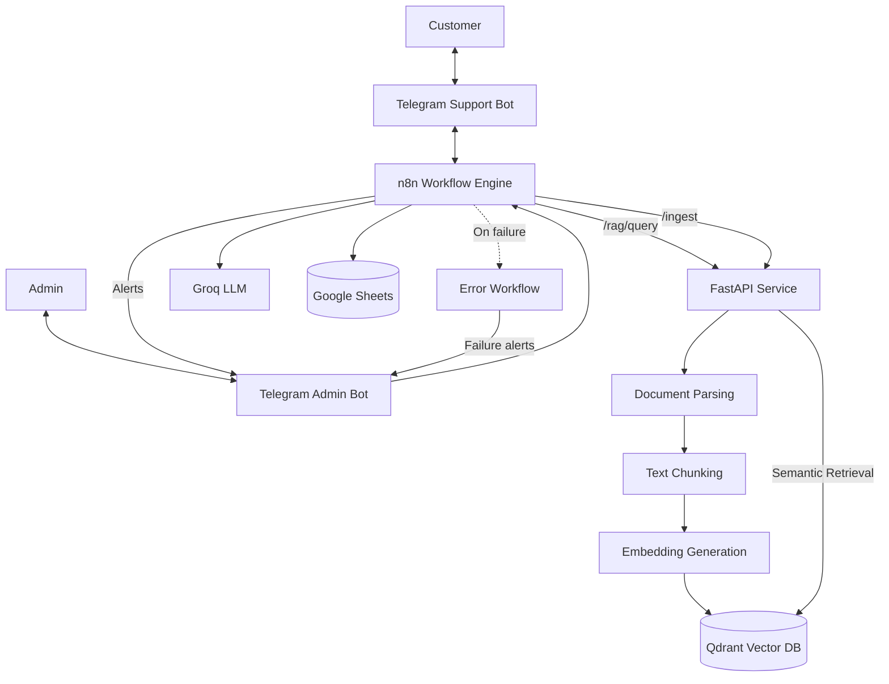
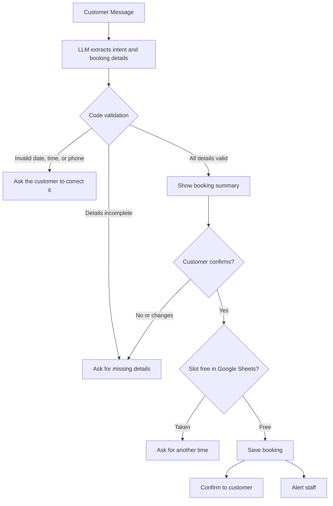

# Smart Support & Lead Agent

### AI-Powered Customer Support, Booking & Lead Capture on Telegram

Smart Support & Lead Agent is an AI customer-support system that answers questions from a business's own documents, books appointments, captures leads, and hands the conversation to a human when it is not confident.

It combines document parsing, vector search, Retrieval-Augmented Generation (RAG), an LLM, and n8n workflow automation, delivered to customers through a Telegram bot and backed by a modular FastAPI service.

The demo business is a fictional dental clinic, **Smile Clinic**. Replacing the clinic's documents with another company's files adapts the system to a new business without changing the architecture.

## Overview

Most small businesses answer the same questions every day (prices, opening hours, policies) and lose customers who write outside working hours. Generic chatbots make this worse: they invent answers and never tell the staff when a real customer needs attention.

This project answers only from the company's own files, says so when it does not know, and escalates to a person instead of guessing.

The system includes:

- **Document Ingestion:** Parse company documents, split them into chunks, embed them, and store them in a vector database.
- **Semantic Retrieval:** Find the most relevant passages for each customer question, with relevance scores.
- **Retrieval-Augmented Generation:** Generate replies grounded in the retrieved passages, with the source named.
- **Confidence Gate:** Escalate to a human when retrieval confidence is low or the answer is not in the documents.
- **Conversational Booking:** Collect service, date, time, name, and phone in natural language, validate them, check for double-booking, and save the booking.
- **Lead and Conversation Logging:** Store bookings and conversation history in Google Sheets.
- **Human Handoff and Alerts:** Notify staff on Telegram for bookings, complaints, and low-confidence questions.
- **Admin Knowledge Upload:** Index new documents by sending them to a private admin bot.
- **Error Handling:** Retries, fallback replies, and a dedicated error workflow that alerts the developer.

## Application Experience

Customers interact with the system entirely inside Telegram. No app, website, or API knowledge is needed.

The Telegram bot is connected to n8n, which orchestrates the workflow and calls the FastAPI service for retrieval. The business owner uses a separate private admin bot to upload documents and receive alerts.

### Customer Workflow

1. **Start a Chat:** The customer sends `/start` to the support bot and receives a bilingual welcome message.
2. **Ask a Question:** The customer asks about prices, hours, policies, or services in Arabic or English.
3. **Context Retrieval:** n8n sends the question to FastAPI, which searches the vector database and returns relevant passages with scores.
4. **Answer Generation:** n8n builds a prompt from the passages, the short conversation history, and the current booking draft, then calls the LLM.
5. **Rule Enforcement:** A code step parses the model output and applies the business rules: confidence threshold, handoff conditions, and booking validation.
6. **Reply or Escalate:** The bot replies with the answer and its source, or passes the customer to a human.
7. **Book an Appointment:** The customer asks to book, the bot collects the missing details, shows a summary, and waits for confirmation.
8. **Confirm and Notify:** After confirmation the booking is checked against existing bookings, saved to Google Sheets, confirmed to the customer, and announced to staff.

### Admin Workflow

1. The admin sends a document (for example a price list) to the private admin bot.
2. n8n downloads the file and sends it to the FastAPI `/ingest` endpoint.
3. The service parses, chunks, embeds, and indexes the document.
4. The admin bot replies with a success or failure message.

## Preview

Explore the project screenshots below:

**Quick Navigation**

- [Project Poster](#1-project-poster)
- [n8n Workflow](#2-n8n-workflow)
- [Telegram Conversation](#3-telegram-conversation)

### 1. Project Poster

[](/docs/images/poster.png)

### 2. n8n Workflow

The main workflow handles routing, retrieval, LLM calls, booking logic, and notifications.

[](/docs/images/n8n_workflow.png)

### 3. Telegram Conversation

A customer asks a question from the documents, then books an appointment.

[](/docs/images/telegram_chat.png)

*Click any screenshot to open the full-size image.*

## System Architecture

The system separates channel handling, orchestration, retrieval, and data storage.



## Booking Flow

Booking is a guided conversation. The model extracts details, but code decides what is valid.



## n8n Workflows

| Workflow | Purpose |
|---|---|
| `Smile Clinic - User.json` | Customer chat, retrieval, LLM reply, booking, handoff, logging |
| `Smile Clinic - Admin.json` | Admin document upload and ingestion |
| `Smile Clinic - Error Handler.json` | Alerts the developer when a workflow fails |

The workflows are exported as JSON, with credentials, secrets, and personal identifiers removed.

## Key Features

- **Grounded Answers:** Replies come from the company's documents, with the source named.
- **Confidence Gate:** Low-confidence or unanswerable questions are escalated instead of guessed.
- **Conversational Booking:** Natural-language booking, including relative dates such as "tomorrow".
- **Code-Level Validation:** Dates, working hours, and phone numbers are validated in code, not by the model.
- **Confirmation Step:** Nothing is saved until the customer confirms a summary.
- **Double-Booking Protection:** Occupied time slots are detected and rejected.
- **Human Handoff:** Complaints, low-confidence questions, and the `/human` command alert staff.
- **Bilingual:** Arabic and English, including Egyptian-dialect phrasing.
- **Conversation Memory:** Recent messages are kept per chat so the bot can follow the booking flow.
- **Admin Ingestion:** Add or update knowledge by sending a file to the admin bot.
- **Resilience:** Retries on external calls and fallback replies if the LLM is unavailable.
- **Modular Design:** Chat, ingestion, and error handling are separate, independently testable workflows.

## Core Components

### 1. Document Parsing and Chunking

The service converts uploaded documents into clean text and splits them into chunks suitable for retrieval. Each chunk keeps metadata such as its source document.

### 2. Embeddings and Vector Search

Chunks are converted into embeddings and stored in Qdrant. At question time the query is embedded and the most similar chunks are returned with relevance scores. The score drives the confidence gate in n8n.

### 3. LLM Reply and Extraction

n8n builds a prompt from the retrieved context, the conversation history, and the current booking draft. The LLM returns a structured JSON result containing the intent, the reply, and the booking details. The prompt instructs the model to answer only from the provided context.

### 4. Business Rules Layer

A code step parses the model output and enforces the rules: confidence threshold, handoff conditions, working hours, date and phone validation, and the confirmation requirement. The model never writes to the database directly.

### 5. Orchestration and Notifications

n8n routes each message, runs the booking path, writes to Google Sheets, and sends Telegram alerts to staff.

## Technology Stack

| Component | Technology |
|---|---|
| Backend API | Python, FastAPI |
| Workflow Automation | n8n |
| Channel | Telegram Bot API (customer bot and admin bot) |
| Vector Database | Qdrant |
| Embedding Generation | Embedding Model Pipeline |
| LLM Inference | Groq API (model configurable in n8n) |
| Data Store | Google Sheets (bookings and conversation log) |
| Package Management | uv |
| API Documentation | OpenAPI / Swagger UI |
| Local HTTPS Tunnel | ngrok (development) |

## Project Structure

```text
Smart-Support-Agent/
├── docs/
│   └── images/
│       ├── poster.png
│       ├── n8n_workflow.png
│       └── telegram_chat.png
├── n8n/
│   ├── Smile Clinic - User.json
│   ├── Smile Clinic - Admin.json
│   └── Smile Clinic - Error Handler.json
├── scripts/
│   └── sanitize_n8n.py
├── src/
│   └── smart_support_agent/
│       ├── main.py
│       ├── config.py
│       ├── schemas.py
│       ├── routes/
│       │   └── api.py
│       ├── services/
│       │   ├── parser.py
│       │   ├── embeddings.py
│       │   └── qdrant_service.py
│       └── demo_data/
│           ├── 01_price_list.md
│           ├── 02_branches_and_hours.md
│           ├── 03_booking_policy.md
│           ├── 04_doctors_and_specialties.md
│           ├── 05_faqs.md
│           └── 06_post_treatment.md
├── pyproject.toml
├── uv.lock
├── .python-version
└── README.md
```

## Getting Started

### Prerequisites

- Python 3.12+
- uv
- An n8n instance (n8n Cloud or self-hosted)
- Two Telegram bots created with [@BotFather](https://t.me/BotFather): one for customers and one for the admin
- A Groq API key
- A Google account for Google Sheets
- ngrok (or another HTTPS tunnel) so n8n can reach the local API

### 1. Clone the Repository

```bash
git clone https://github.com/ismail-ashraf/Smart-Support-Agent.git
cd Smart-Support-Agent
```

### 2. Install Dependencies

```bash
uv sync
```

### 3. Configure Environment Variables

Create a `.env` file in the project root with the variables read by `src/smart_support_agent/config.py`.

**Important:** Never commit API keys, bot tokens, or the `.env` file to version control.

### 4. Start the FastAPI Service

```bash
uv run uvicorn smart_support_agent.main:app --reload
```

The API will be available at:

```text
http://127.0.0.1:8000
```

Interactive API documentation:

```text
http://127.0.0.1:8000/docs
```

### 5. Expose the API to n8n

If n8n runs in the cloud, it cannot reach `localhost`. Start a tunnel:

```bash
ngrok http 8000
```

Copy the HTTPS URL; you will paste it into the n8n HTTP Request nodes.

### 6. Index the Demo Documents

Send the files in `src/smart_support_agent/demo_data/` to the admin bot (after setting up the admin workflow below), or call the `/ingest` endpoint directly from the Swagger UI.

### 7. Prepare Google Sheets

Create one Google Sheet with two tabs. Put the column names in the first row of each tab and format the columns as plain text.

**Bookings**

```text
booking_id | created_at | chat_id | name | phone | service | date | time | status | source
```

**Conversations**

```text
ts | chat_id | question | intent | top_score | answered_by | action
```

### 8. Import the n8n Workflows

In n8n, create a new workflow, open the `...` menu, choose **Import from file**, and import each file from the `n8n/` folder.

Then, in each workflow:

1. Select your credentials: Telegram, Groq, and Google Sheets.
2. Replace every `REPLACE_...` placeholder (API URL, Sheet ID, admin user ID, staff chat ID).
3. Use the customer bot's credential in the user workflow and the admin bot's credential in the admin workflow and the staff notification node.
4. Link the error handler: open the main workflow, go to **Settings**, set **Error Workflow**, and select it.
5. Publish the user and admin workflows.

Each Telegram bot can have only one active webhook, so the customer bot and the admin bot must use separate workflows.

### 9. Test

Send `/start` to the customer bot, ask a question from the documents, then ask to book an appointment and confirm it. The booking appears in the **Bookings** tab and the staff alert arrives on the admin bot.

## Running the Complete System

| Component | Responsibility |
|---|---|
| Telegram Bots | Customer channel and admin channel |
| n8n | Routing, LLM calls, booking logic, notifications |
| FastAPI | Document ingestion and semantic retrieval |
| Qdrant | Stores vector embeddings and document chunks |
| Groq | LLM inference |
| Google Sheets | Bookings and conversation log |
| ngrok | Public HTTPS URL for local development |

Make sure FastAPI and the tunnel are running before testing the workflows.

## API Capabilities

| Capability | Description |
|---|---|
| Document Ingestion | Upload a document, parse it, chunk it, embed it, and index it |
| Semantic Retrieval | Return relevant passages and relevance scores for a question |
| Document Removal | Remove a document from the index |
| Health Check | Check that the service is running |

The exact request and response schemas are available through the interactive API documentation at `/docs`.

## Design Goals

- Answers grounded in company documents, never invented.
- Safe escalation to a human instead of guessing.
- Business rules enforced in code, with the model used for language understanding only.
- Separate, modular workflows for chat, ingestion, and error handling.
- Resilience through retries and fallback replies.
- Secrets kept out of the repository, with sanitized workflow exports.
- Easy adaptation to a new client by replacing the knowledge base.

## Future Improvements

- Evaluation on a labeled question set (correct answers, correct refusals, latency) and threshold tuning.
- Persistent conversation memory in a database instead of workflow storage.
- API-key authentication for the FastAPI service.
- Daily summary report workflow.
- WhatsApp channel and calendar integration.
- Admin dashboard and production deployment with Docker Compose.

## Author

**Ismail Ashraf**

---

*Smart Support & Lead Agent: Answering from your documents, booking in the chat, and handing off when it matters.*
